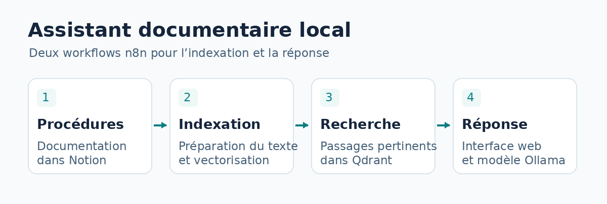
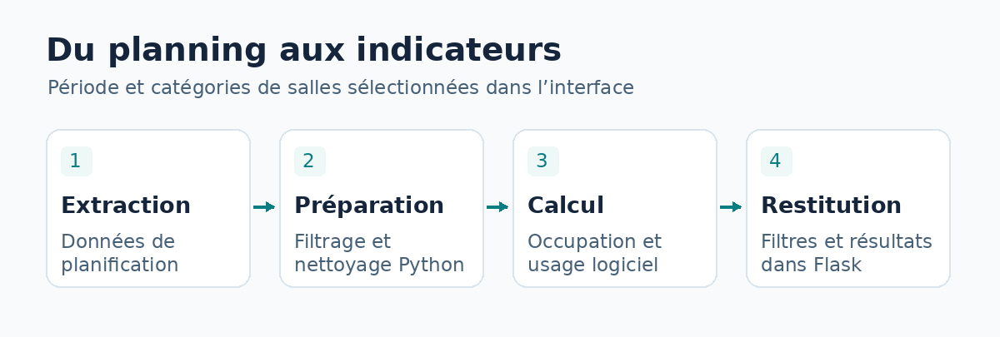
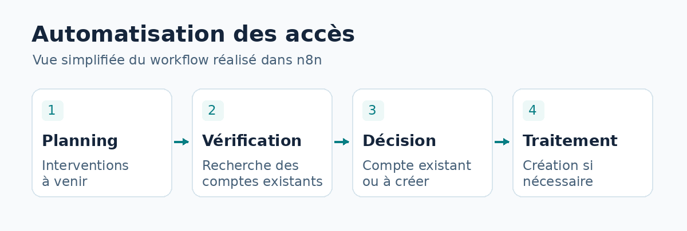

# Stage Data et automatisation — Centreville Télévision

**Kajan Arulnathan · BUT Informatique · 20 avril au 12 juin 2026**

[Lire le rapport public (PDF)](Rapport-stage-public-Kajan-Arulnathan.pdf) · [Voir mon portfolio](https://kajan94.github.io/Portefolio/)

## Assistant de recherche documentaire

J’ai développé deux workflows n8n. Le premier prépare et vectorise les procédures Notion pour les indexer dans Qdrant. Le second recherche les passages pertinents et les transmet au modèle exécuté localement avec Ollama. Une interface web permet aux techniciens de poser une question et de démarrer une nouvelle discussion.

Mon tuteur a validé le workflow. La précision des réponses et le temps de traitement dépendaient du modèle et du matériel disponibles.

## Tableau de bord d’occupation

J’ai développé une extraction Python et une interface Flask pour analyser les réservations. Le tableau de bord affiche le taux d’occupation par catégorie de salle, la répartition des logiciels utilisés et un inventaire filtrable. Les résultats d’une semaine ont été comparés au planning d’origine avec mon tuteur.

[Aperçu des indicateurs sur données fictives](https://github.com/user-attachments/assets/8068cb09-c72c-403f-87eb-58b3be9bf2a7) · [Aperçu de l’inventaire sur données fictives](https://github.com/user-attachments/assets/31370ec9-5c57-4110-af7a-aff045128d2b)

## Automatisation des accès

J’ai conçu un flux n8n qui récupère les interventions prévues, vérifie les comptes existants et lance une création lorsqu’elle est nécessaire.

Les visuels résument les étapes fonctionnelles et les résultats publics du stage. Deux pistes de poursuite sont l’historisation des indicateurs et l’évaluation d’un modèle local plus performant.
